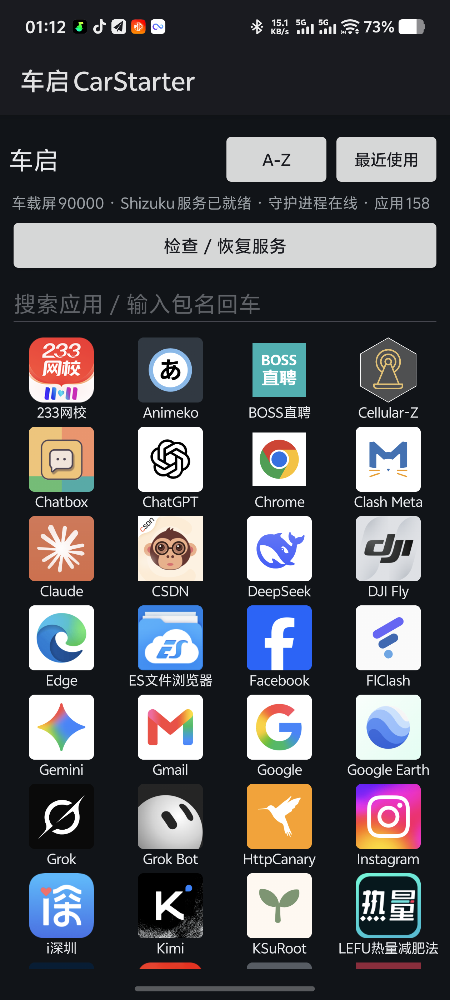
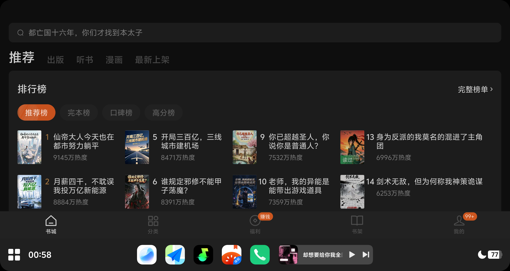

# 实际截图

以下为本次现场保存的原始屏幕截图，未重绘、未裁剪。截图日期为 2026-10-25。图片尺寸、版本语境和 SHA-256 见 [图片记录](images/manifest.json)。

## v15: 手机启动器与 Shizuku 状态

手机端实际界面显示“Shizuku 服务已就绪”“守护进程在线”，并提供“检查 / 恢复服务”按钮。应用枚举在该设备上为 158 个，不代表这些应用均已通过投屏验收。

[查看原图](images/v15-phone-shizuku-ready.png)

## v13: 番茄冷启动的车载画面，历史验证

这张截图来自 v13 的原生图标点击路径。番茄冷启动后，底部导航显示在车机 dock 上方，是当时安全区验证的现场记录。

**该启动路径已在 v14 停用。当前 v15 使用直接启动，不能用这张旧截图证明当前路径的安全区或按需全屏已经完成。**

[查看原图](images/v13-car-fanqie-cold-start.png)
